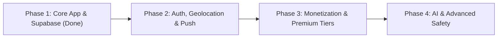

# 🗺️ Crush - Product & Engineering Roadmap

This roadmap outlines the past milestones, current capabilities, and future vision for **Crush** — from core swipe mechanics to AI-assisted matching, safety systems, and global monetization.

---

## 🧭 Milestone Overview

---

## ✅ Phase 1: Core MVP & Foundation *(Completed)*

- [x] **Flutter Architecture & Theme**
  - Material 3 design system with signature rose/coral romantic gradients (`#FD297B` to `#FF655B`).
  - Dark mode by default with typography powered by *Plus Jakarta Sans*.
  - Provider state architecture separating Auth, Discovery, and Chat concerns.
- [x] **Gesture Card Swiping Deck**
  - Smooth physics-driven card drag gestures (Swipe Right to Like, Left to Pass, Up to Super Crush).
  - Multi-photo carousel on cards with story progress bars and touch edge zones.
  - Action buttons with micro-press animations: Rewind, Dislike, Super Crush, Like, and Boost.
- [x] **Match System & Celebrations**
  - Automatic PostgreSQL trigger (`handle_swipe_match`) detecting mutual likes in the database.
  - Animated celebration dialog showing interlocking avatars, heart pulse, and instant chat CTA.
- [x] **Realtime Chat & Icebreakers**
  - Live 1-on-1 messaging powered by Supabase Realtime publications.
  - Horizontal carousel for new match stories.
  - Interactive icebreaker suggestion pills to easily kickstart conversations.
- [x] **Discovery Filters & Profile Management**
  - Distance (5–100 km), age range (18–60), and gender preference filters.
  - Photo grid management (up to 6 photos) and 20+ passion tags.
  - `avatars` public storage bucket with user-isolated RLS upload policies.
- [x] **Zero-Config Demo Mode**
  - Offline fallback with rich Unsplash portrait profiles and automated reply bot for instant preview.

---

## 🚀 Phase 2: Enhanced Identity, Geo & Push *(Next Up)*

- [ ] **Phone Number (SMS) Authentication**
  - Integrate Supabase Phone Provider (Twilio / MessageBird) for SMS verification codes.
  - Auto-SMS retrieval on Android and iOS.
- [ ] **Social Authentication**
  - Sign in with Apple (mandatory for iOS App Store compliance on social apps).
  - Sign in with Google (OAuth2).
- [ ] **Live Geolocation & PostGIS Queries**
  - Device GPS coordinate capture via `geolocator`.
  - Supabase PostGIS spatial query (`ST_DWithin` & `ST_DistanceSphere`) to compute live distances and query profiles within user radius.
- [ ] **Push Notifications**
  - Firebase Cloud Messaging (FCM) & Apple Push Notification service (APNs).
  - Background notifications for: *"You got a new Crush!"*, *"Someone liked you"*, and new chat messages.
- [ ] **Audio & Voice Messages in Chat**
  - Record and send waveform voice notes directly in chat screen.

---

## 💎 Phase 3: Premium Features & Monetization *(Q2)*

- [ ] **In-App Purchases & Subscriptions**
  - Integrate **RevenueCat** SDK for unified iOS App Store & Google Play Store billing.
- [ ] **Crush Gold Subscription**
  - **"See Who Liked You"**: Grid view revealing users who already swiped right on you.
  - **Unlimited Swipes**: Remove the daily like cap.
  - **5 Free Super Crushes daily**.
  - **Passport Mode**: Change your GPS location to match with singles in any city worldwide.
  - **Unlimited Rewinds**: Undo any accidental left swipe.
- [ ] **Crush Platinum Subscription**
  - **Priority Likes**: Your profile card gets placed at the top of other users' discovery decks.
  - **Message Before Match**: Attach a note when sending a Super Crush.
- [ ] **Consumable Packs**
  - **Crush Boost**: 30-minute top profile placement in your local area (10x impressions).
  - **Super Crush Packs**: Buy packs of 5, 15, or 30 Super Crushes.

---

## 🛡️ Phase 4: Trust, Safety & AI *(Q3)*

- [ ] **Photo Verification with Selfie Liveness**
  - Pose verification (e.g. "turn head left, smile") using on-device ML Kit.
  - Blue checkmark badge granted upon automated face comparison.
- [ ] **AI-Powered Icebreaker & Conversation Coach**
  - Contextual opener generation using Google Gemini API based on the match's mutual interests and bio prompts.
  - Real-time conversation health nudges to prevent chats from stalling.
- [ ] **Trust & Safety Center**
  - Date Check-In: Share date details & live location with emergency contacts.
  - Incognito Mode: Only people you've swiped right on can see your profile.
  - Hide from Contacts: Block friends, exes, and coworkers by syncing phone contact hashes.
- [ ] **In-App Audio / Video Dates**
  - Peer-to-peer encrypted audio and video calling via WebRTC / Agora SDK without sharing phone numbers or social handles.

---

## 📊 Suggested Implementation Priorities

| Priority | Feature | Complexity | Impact |
| :--- | :--- | :--- | :--- |
| **P0** | Apple & Google Sign-In | Medium | Critical for App Store approval |
| **P0** | Push Notifications (FCM / APNs) | Medium | Essential for user retention |
| **P1** | Live GPS & PostGIS Distance Queries | Medium | Core discovery relevance |
| **P1** | RevenueCat Subscriptions (Crush Gold) | High | Monetization & revenue |
| **P2** | Selfie Verification Badge | Medium | Trust & bot prevention |
| **P2** | Gemini AI Conversation Starters | Low | Engagement & uniqueness |
| **P3** | In-app 1-on-1 Video Calling | High | Premium user experience |
