# 🗺️ Crush - Product & Engineering Roadmap

This roadmap outlines completed milestones, current capabilities, and future vision for **Crush** — from core swipe mechanics and native authentication to page-by-page UX polish, real-time messaging, AI safety, and global monetization.

---

## 🧭 Milestone Overview

```mermaid
flowchart LR
    A["Phase 1: Core MVP & Backend (Done)"] --> B["Phase 1.5: Brand & Light Theme (Done)"]
    B --> C["Phase 2: Native Auth, Storage & TestFlight (Done)"]
    C --> D["Phase 2.5: Cloud Storage & Push Notifications (Done)"]
    D --> E["Phase 3: Page-by-Page UX Polish (Current)"]
    E --> F["Phase 4: Geolocation & Deep Chat"]
    F --> G["Phase 5: Subscriptions & Monetization"]
    G --> H["Phase 6: AI Matching & Trust Safety"]
```

---

## ✅ Phase 1: Core MVP & Foundation *(Completed)*

- [x] **Flutter Architecture & Clean State Management**
  - Modular clean-architecture project structure (`core`, `models`, `providers`, `ui`, `services`).
  - Provider state architecture separating Auth, Discovery, and Chat concerns.
  - Live Supabase connection with graceful fallback handling.
- [x] **Gesture Card Swiping Deck**
  - Card swiper with physics-driven gestures (Right: Like, Left: Pass, Up: Super Crush).
  - Multi-photo carousel on cards with story progress indicators and tap edge navigation.
  - Floating action buttons: Rewind, Dislike, Super Crush, Like, and Boost.
- [x] **Live Supabase Backend & Database Schema**
  - PostgreSQL schema with Row-Level Security (RLS) on `profiles`, `swipes`, `matches`, and `messages`.
  - Database triggers for reciprocal match creation and message timestamp updates.
  - Realtime publication stream enabled for live chat and match notifications.
- [x] **Discovery Filters & Profile Detail Sheet**
  - Dynamic discovery filters: Distance slider (5–100 km), Age range slider (18–60), and Gender preference.
  - Profile detail modal bottom sheet with photo gallery, bio, work, school, and passion chips.

---

## ✅ Phase 1.5: Brand Identity, High-Contrast UI & Performance *(Completed)*

- [x] **Brand Identity & Asset Suite**
  - Custom **crush** logo typography featuring a soft coral heart nested inside the `"u"`.
  - Master high-res transparent wordmark (`logo_wordmark.png`).
  - Full suite of iOS App Icons (15 resolutions in `AppIcon.appiconset`) and Android mipmap launcher icons.
- [x] **Flutter Native Splash Screen & Animated In-App Splash**
  - Integrated `flutter_native_splash` for instant native app launch on iOS and Android.
  - Custom animated `SplashScreen` with heartbeat pulsing heart, ambient glow, and tagline reveal.
  - Smart auth-state routing into `AuthGate`.
- [x] **Crisp High-Contrast Light Theme Overhaul**
  - Switched to clean, modern, high-contrast light theme:
    - **Background**: Pure `#FFFFFF` and Warm Ivory (`#FFF8F2`).
    - **Containers & Search**: `#F3F4F6` with subtle `#E5E7EB` borders.
    - **Typography**: Deep Charcoal `#111827` (Headings) and Slate Grey `#4B5563` (Subtitles/Bios).
    - **Brand Accent**: Punchy Peach-Coral `#FF5364` on action buttons, badges, and active tabs.
- [x] **Complete Purge of Mock Data & Accounts**
  - Removed all mock accounts (`alex@crush.app`, `maya`, `chloe`, `elena`, `sarah`, `zara`).
  - Deleted `supabase/seed.sql` and removed all sample photo buttons and demo fallbacks.
  - 100% real Supabase database and authentication flow.

---

## ✅ Phase 2: Production Auth, Storage, Store Compliance & TestFlight *(Completed)*

- [x] **Native Authentication Gateways**
  - **Sign in with Apple**: Native iOS bottom sheet with Face ID / Touch ID, SHA-256 cryptographic nonce hashing, and user metadata capture.
  - **Sign in with Google**: Native Google Sign-In SDK (1-tap sheet) with automatic cache cleanup (`signOut` on retry) and browser OAuth fallback.
  - **Email & Password Authentication**: Polished login card with real-time field validation, focus-node chaining, and error feedback.
  - **Reactive 3-State Auth Machine**: Clean separation between Unauthenticated &rarr; Needs Onboarding &rarr; Fully Authenticated (`HomeNavigationScreen`).
- [x] **9-Step Guided Onboarding Flow**
  - First Name identity gate (prevents impersonation).
  - Cupertino date wheel with strict 18+ legal age verification check.
  - Gender identity & dating preference selection.
  - Relationship intentions / dating goals with punchy tags.
  - 6-slot photo grid with primary avatar badge.
  - Searchable interest chip selector (5+ required).
  - Location setup with automatic pre-fill.
  - Bio, occupation, and school configuration.
  - 4-point community safety pledge.
- [x] **App Store & Google Play Policy Compliance**
  - Apple Guideline 5.1.1(v) permanent in-app **Account Deletion** flow with confirmation dialog.
  - Apple Guideline 1.2 **Block & Report User** safety controls in chat & profile details.
  - iOS `NSCameraUsageDescription`, `NSPhotoLibraryUsageDescription`, and `ITSAppUsesNonExemptEncryption = false`.
  - Android release permissions (`INTERNET`, `CAMERA`, `READ_MEDIA_IMAGES`).
  - Hosted legal pages deployed on GitHub Pages:
    - Privacy Policy: `https://venky24k.github.io/crush/privacy.html`
    - Terms of Service: `https://venky24k.github.io/crush/terms.html`
    - Landing Page: `https://venky24k.github.io/crush/`
  - In-app interactive legal bottom sheet on login screen.
- [x] **Production iOS Release & TestFlight**
  - Production `.ipa` built, code-signed, and delivered via Apple Transporter.
  - App Store Connect app record registered (`com.vardhan.crush.app`).
  - App encryption export compliance verified & build live on **Apple TestFlight**.

---

## ✅ Phase 2.5: Cloud Storage, Real-Time Sync & Push Notifications *(Completed)*

- [x] **Supabase Storage Public `avatars` Bucket**
  - Bucket initialized and made public with authenticated upload/update RLS policies.
  - `uploadProfilePhoto()` updated with strict MIME detection (`image/jpeg`, `image/png`, `image/webp`) and `FileOptions(upsert: true)`.
  - Purged local file paths from remote database persistence — only verified CDN URLs saved.
- [x] **Real-Time Match Alerts & Live Chat Delivery**
  - Subscribed `ChatProvider` to Supabase Realtime WebSocket changes on `public.matches`.
  - Floating in-app match notification banner: *"🎉 IT'S A CRUSH! You and [Name] liked each other!"* with direct "Say Hi 👋" chat shortcut.
  - Live unread badge count updates on the bottom navigation bar.
  - Real-time message streaming inside `ChatScreen` with auto-scroll on arrival.
- [x] **Apple Push Notifications (APNs) & Firebase Cloud Messaging (FCM)**
  - Apple `.p8` Push Notification Authentication Key uploaded to Firebase Console for both Development and Production.
  - Bundled `GoogleService-Info.plist` and configured Xcode build resources.
  - Added `aps-environment` to `Runner.entitlements` and `remote-notification` to `UIBackgroundModes` in `Info.plist`.
  - Integrated `firebase_core` & `firebase_messaging` with `NotificationService` for permission prompts and device token syncing to Supabase `profiles.fcm_token`.
- [x] **Swipe Card Image Performance & 0ms Loading**
  - **4-Card Proactive Pre-Caching**: Pre-decodes upcoming 4 profiles into memory ahead of time.
  - **In-Card Story Pre-Caching**: All photos of the active card pre-cached on mount for instant 0ms photo taps.
  - **Downsampled Memory Decoding (`memCacheWidth: 1080`)**: 90% drop in RAM per image (~45 MB &rarr; ~3 MB), eliminating swipe gesture jank and maintaining 60/120 FPS.
  - **Warm Skeleton Placeholder**: Replaced blank boxes with a warm ivory gradient skeleton and subtle brand heart watermark, plus 200ms smooth cross-fade.

---

## 🎨 Phase 3: Page-by-Page UX Polish & Micro-Interactions *(Current Sprint)*

This phase elevates Crush from a working prototype into a consumer-grade dating app with fluid physics, haptics, and delight across each individual screen:

### 🃏 3.1 Discovery & Swipe Card Screen
- [x] **0ms Instant Photo Switching**: Pre-cached photo carousel with story progress indicators.
- [x] **Smooth Memory Downsampled Cards**: 1080p memory decoding eliminating swipe stutter.
- [ ] **Swipe Haptic Feedback**: Light haptic tick on drag threshold; crisp tactile feedback on Like, Nope, and Super Like (`HapticFeedback.mediumImpact()`).
- [ ] **Rewind / Undo Action**: Functional rewind restoring the previously swiped card back to the top of the deck.
- [ ] **Super Like Particle Burst**: Animated gold/coral star burst with micro-confetti on Super Like.
- [ ] **Match Celebration Screen**: Synchronized dual-photo pulse animation with instant "Send a message" input field.

### 📝 3.2 Onboarding Flow (9 Steps)
- [ ] **Hinge-Style Personality Prompts**: Pick and answer 2–3 fun prompt cards (*"A typical Sunday for me looks like...", "My biggest green flag is..."*).
- [ ] **Photo Quality Validator & Drag Reorder**: Drag-and-drop to reorder photo hierarchy; minimum resolution hints.
- [ ] **Animated Step Indicator**: Smooth sliding progress bar with percentage and step transitions.

### 💬 3.3 Matches & Real-Time Chat
- [x] **Real-Time Live Chat**: Instant message arrival via Supabase Realtime without manual refresh.
- [ ] **Interactive Conversation Starters**: Tappable icebreaker question pills in empty chats that auto-fill the input field.
- [ ] **Online Activity Indicators & Read Receipts**: Real-time "Active now" badges and `✓✓` read receipts on delivered messages.
- [ ] **In-Chat Photo Sharing**: Camera and gallery attachments directly inside private conversations.
- [ ] **Typing Indicator Animation**: Animated 3-dot bubble showing when the other person is typing.

### 👤 3.4 User Profile & Edit Suite
- [ ] **"Preview Profile" Mode**: 1-tap preview toggle allowing users to view their profile exactly as prospective matches see it.
- [ ] **Profile Completeness Gauge**: Circular or bar meter (*"85% complete — add 2 more passions to get 3x matches"*).
- [ ] **Discovery Preference Controls**: Age range dual-slider and distance radius slider saving directly to Supabase profile preferences.

### 🔐 3.5 Login & Welcome Gateway
- [x] **Polished Real-Time Validation**: Field-level validation on email/password with styled error snackbars.
- [x] **Focus-Node Chaining**: Seamless keyboard return key navigation (Email &rarr; Password &rarr; Submit).
- [ ] **Ambient Motion Background**: Subtle floating coral/warm ivory gradient or gentle heart particles.
- [ ] **Spring Micro-Interactions**: Tactile button press bounce on Apple, Google, and Email sign-in buttons.

---

## 📍 Phase 4: Geolocation & Deep Chat *(Next Up)*

- [x] **Push Notifications (APNs / FCM)**: Client SDK, tokens, credentials, and background modes configured.
- [ ] **Supabase Edge Function Push Trigger**: Database webhook firing FCM HTTP v1 notifications on new matches and messages.
- [ ] **Live Geolocation & PostGIS Distance Queries**
  - Device GPS coordinate capture via `geolocator` with permission dialogs.
  - PostgreSQL PostGIS queries (`ST_DWithin`, `ST_DistanceSphere`) to calculate exact distances and filter profiles dynamically within the user's selected radius.
- [ ] **Voice Notes & Audio in Chat**
  - In-chat voice recording and playback with interactive waveform visualizers.

---

## 💎 Phase 5: Premium Features & Monetization *(Q2)*

- [ ] **RevenueCat In-App Purchases (IAP)**
  - Integration with Apple StoreKit 2 and Google Play Billing via RevenueCat.
  - Paywall screens with introductory trials and subscription tiers.
- [ ] **Crush Gold Subscription**
  - **"See Who Liked You"**: Grid view displaying users who already swiped right on your profile.
  - **Unlimited Swipes**: Remove the standard 50 likes/12-hour limit.
  - **5 Free Super Crushes Daily**.
  - **Passport Mode**: Travel to any city in the world to browse and match prior to visiting.
  - **Unlimited Rewinds**: Undo any accidental pass.
- [ ] **Crush Platinum Subscription**
  - **Priority Likes**: Card placed at the top of the deck for users you like.
  - **Note with Super Crush**: Send a personalized note before matching.
- [ ] **Consumable Packs**
  - **Crush Boost**: 30-minute top profile placement in your local area (up to 10x visibility).
  - **Super Crush Bundles**: Packs of 5, 15, or 30 Super Crushes.

---

## 🛡️ Phase 6: Trust, Safety & AI *(Q3)*

- [ ] **Selfie Photo Verification**
  - On-device liveness and pose verification (e.g. smile, head tilt) using ML Kit.
  - Blue verified badge issued upon automated facial match against profile pictures.
- [ ] **Gemini AI Conversation Coach & Icebreakers**
  - Contextual opener generation powered by the Google Gemini API using mutual interests and bio prompts.
  - Chat revival suggestions when a conversation goes quiet.
- [ ] **Safety & Privacy Center**
  - **Date Check-In**: Share date details and live location with trusted emergency contacts.
  - **Incognito Mode**: Hide profile from discovery; visible only to profiles you swipe right on.
  - **Block Contacts**: Prevent friends, exes, and coworkers from seeing your profile via hashed contact matching.
- [ ] **Encrypted Audio / Video Dates**
  - Secure 1-on-1 peer-to-peer video calls using WebRTC / Agora SDK without sharing phone numbers or personal handles.

---

## 📊 Feature Priority Matrix

| Priority | Feature | Complexity | Impact | Status |
| :--- | :--- | :--- | :--- | :--- |
| **P0** | Native Sign in with Apple & Google OAuth | Medium | Essential for Launch | ✅ Completed |
| **P0** | Supabase Cloud Photo Storage (`avatars`) | Medium | Core App Functionality | ✅ Completed |
| **P0** | Push Notifications (APNs / FCM Client & Config) | Medium | Daily Active Retention | ✅ Completed |
| **P0** | In-App Real-Time Match Alerts & Live Chat | Medium | User Engagement | ✅ Completed |
| **P0** | Swipe Deck 0ms Pre-Caching & Downsampling | Low | Core Swiping Feel | ✅ Completed |
| **P0** | Swipe Haptics & Visual Feedback | Low | Tactile Delight | 🎨 In Progress |
| **P0** | Chat Icebreaker Chips & Read Receipts | Low | Retention & Conversation Rate | 🎨 In Progress |
| **P1** | Supabase Edge Function Push Trigger | Medium | Lock Screen Engagement | 📍 Phase 4 |
| **P1** | Live GPS & PostGIS Distance Queries | Medium | Discovery Relevance | 📍 Phase 4 |
| **P1** | RevenueCat Subscriptions (Crush Gold) | High | Direct Monetization | 💎 Phase 5 |
| **P2** | Selfie Liveness Verification Badge | Medium | Trust & Anti-Bot Safety | 🛡️ Phase 6 |
| **P2** | Gemini AI Conversation Starters | Low | Chat Engagement | 🛡️ Phase 6 |
