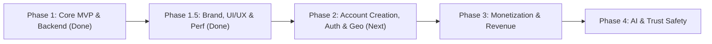

# 🗺️ Crush - Product & Engineering Roadmap

This roadmap outlines the completed milestones, current capabilities, and future vision for **Crush** — from core swipe mechanics to comprehensive account onboarding, AI-assisted matching, safety systems, and global monetization.

---

## 🧭 Milestone Overview

---

## ✅ Phase 1: Core MVP & Foundation *(Completed)*

- [x] **Flutter Architecture & State Management**
  - Modular clean-architecture project structure (`core`, `models`, `providers`, `ui`, `services`).
  - Provider state architecture separating Auth, Discovery, and Chat concerns.
  - Zero-config offline Demo Mode with 5 rich mock profiles and simulated automated chat replies.
- [x] **Gesture Card Swiping Deck**
  - Card swiper with physics-driven gestures (Right: Like, Left: Pass, Up: Super Crush).
  - Multi-photo carousel on cards with story progress indicators and tap edge navigation.
  - Floating action buttons with micro-press physics: Rewind, Dislike, Super Crush, Like, and Boost.
- [x] **Live Supabase Backend & Database Schema**
  - PostgreSQL schema with Row-Level Security (RLS) on `profiles`, `swipes`, `matches`, and `messages`.
  - Database triggers:
    - `handle_swipe_match`: Automatically creates mutual matches on reciprocal likes.
    - `handle_new_message`: Updates match `last_message` and timestamps in realtime.
  - Supabase Storage `avatars` bucket with user-isolated upload and delete policies.
  - Realtime publication stream enabled for live chat and match notifications.
- [x] **Realtime Messaging & Icebreakers**
  - 1-on-1 chat interface with message bubbles, status indicators, and photo avatars.
  - Interactive icebreaker suggestion pills to easily start conversations.
  - Active matches horizontal story bar.
- [x] **Discovery Filters & Profile Editing**
  - Dynamic discovery filters sheet: Distance slider (5–100 km), Age range slider (18–60), and Gender preference.
  - Profile detail modal bottom sheet with photo gallery, bio, work, school, and passion chips.
  - Profile edit screen supporting bio updates and multi-photo management.

---

## ✅ Phase 1.5: Brand Identity, High-Contrast UI & Performance *(Completed)*

- [x] **Brand Identity & Asset Suite**
  - Custom **crush** logo typography featuring a soft coral heart nested inside the `"u"`.
  - Master high-res transparent wordmark (`logo_wordmark.png`) and full logo (`logo_transparent.png`).
  - Full suite of iOS App Icons (15 resolutions from 20×20 to 1024×1024 in `AppIcon.appiconset`).
  - Complete Android mipmap launcher icons (`mdpi`, `hdpi`, `xhdpi`, `xxhdpi`, `xxxhdpi`).
- [x] **Flutter Native Splash Screen**
  - Integrated `flutter_native_splash` for instant native app startup on iOS and Android.
  - Branded launch screen on Warm Ivory (`#FFF8F2`) background with the centered logo wordmark.
  - Smooth native-to-Flutter transition using `FlutterNativeSplash.preserve()` and `.remove()`.
- [x] **Crisp High-Contrast Light Theme Overhaul**
  - Switched from dark muddy tones to a clean, modern, high-contrast light theme:
    - **Background**: Pure `#FFFFFF` for crisp readability across Discovery, Matches, and Chat.
    - **Containers & Search**: `#F3F4F6` (Light Neutral Grey) with subtle `#E5E7EB` borders.
    - **Typography**: Deep Charcoal `#111827` (Headings) and Slate Grey `#4B5563` (Subtitles/Bios).
    - **Brand Accent**: Punchy Peach-Coral `#FF5364` on action buttons, badges, and active tabs.
- [x] **60 FPS Swiping & Rendering Optimization**
  - Eliminated swipe stutter by removing mid-animation `notifyListeners()` calls during swipe events.
  - Implemented granular `Selector` rebuild scopes for card deck state and rewind button state.
  - Added `RepaintBoundary` wrappers around swipe cards and app bar components.
  - Fixed Material layering and invisible ink splash assertions across list tiles and bottom sheets.
  - Guarded photo carousel indices and dynamic card counts against `RangeError` exceptions.

---

## 🚀 Phase 2: Production Account Creation, Auth & Geolocation *(Next Up)*

### 👤 2.1 Complete Account Creation & Guided Onboarding Flow

- [ ] **Multi-Provider Authentication Gateways**
  - **Sign in with Apple**: Native Sign-In flow with Apple Developer Service ID and Supabase Apple Auth (mandatory for iOS App Store approval).
  - **Sign in with Google**: One-tap OAuth 2.0 flow with profile pre-fill (name, photo, email).
  - **Phone Number (SMS OTP)**: Phone number verification with 6-digit auto-fill via Twilio / MessageBird on Supabase.
  - **Email / Password**: With format validation and instant sign-up confirmation.
- [ ] **Multi-Step Guided Profile Creation Funnel (Interactive Wizard)**
  - **Step 1: First Name**: Required display name (locked post-creation to prevent catfishing and impersonation).
  - **Step 2: Birthday & Age Verification**:
    - Cupertino/Material date picker enforcing strict 18+ age verification check.
    - Real-time age display with legal compliance (COPPA & App Store guidelines).
  - **Step 3: Identity & Attraction**:
    - My Gender: *Woman, Man, Non-Binary, Custom*.
    - Show Me (Dating Preference): *Women, Men, Everyone*.
  - **Step 4: Relationship Goals / Intentions**:
    - Select primary intention: *Long-term partner, Casual dating, Marriage-minded, New friends, Still figuring it out*.
  - **Step 5: Photo Upload (Minimum 2 Photos Required)**:
    - 6-slot photo grid with drag-and-drop reordering.
    - Integrated photo cropper & compression before upload to Supabase Storage `avatars/<uid>/`.
    - Primary avatar selector badge (*"Main photo displayed on cards"*).
  - **Step 6: Interests & Passions (Select 5+)**:
    - Searchable categorized interest chip selector (Creativity, Sports, Travel, Food & Drink, Entertainment, Pets).
  - **Step 7: Location Setup & Geocoding**:
    - One-tap GPS permission prompt.
    - Automatic reverse-geocoding into `city` / neighborhood for display on card headers.
  - **Step 8: Bio & Personality Prompts (Hinge-Style)**:
    - Choose 2–3 fun prompt cards (*"A typical Sunday for me looks like...", "My biggest green flag is...", "Dating me is like..."*).
  - **Step 9: Community Pledge & Rules**:
    - Mandatory 4-point anti-harassment, authenticity, and respect pledge before entering the discovery deck.
- [ ] **Progressive Draft Saving & Resumption**
  - Add `onboarding_completed: boolean default false` column to `public.profiles`.
  - Save progress incrementally at each step so users who exit can resume where they left off.
  - `AuthGate` router directs users to complete onboarding before accessing the main feed.

### 📍 2.2 Geolocation & Push Notifications

- [ ] **Live Geolocation & PostGIS Distance Queries**
  - Device GPS coordinate capture via `geolocator` with permission dialogs.
  - PostgreSQL PostGIS queries (`ST_DWithin`, `ST_DistanceSphere`) to calculate exact distances and filter profiles dynamically within the user's selected radius.
- [ ] **Push Notifications (FCM / APNs)**
  - Firebase Cloud Messaging integration for iOS (APNs) and Android.
  - Push triggers on:
    - Mutual match (*"It's a Match! Say hello to [Name]"*).
    - Incoming chat message.
    - Profile super likes.
- [ ] **Voice Notes & Audio in Chat**
  - In-chat voice recording and playback with interactive waveform visualizers.

---

## 💎 Phase 3: Premium Features & Monetization *(Q2)*

- [ ] **RevenueCat In-App Purchases (IAP)**
  - Integration with Apple StoreKit 2 and Google Play Billing via RevenueCat.
  - Paywall screens with introductory trials and subscription tiers.
- [ ] **Crush Gold Subscription**
  - **"See Who Liked You"**: Grid view displaying users who already swiped right on your profile.
  - **Unlimited Swipes**: Remove the standard 50 likes/12-hour limit.
  - **5 Free Super Crushes Daily**.
  - **Passport Mode**: Travel to any city in the world to browse and match prior to visiting.
  - **Unlimited Rewinds**: Undo any accidental pass.
- [ ] **Crush Platinum Subscription**
  - **Priority Likes**: Card placed at the top of the deck for users you like.
  - **Note with Super Crush**: Send a personalized note before matching.
- [ ] **Consumable Packs**
  - **Crush Boost**: 30-minute top profile placement in your local area (up to 10x visibility).
  - **Super Crush Bundles**: Packs of 5, 15, or 30 Super Crushes.

---

## 🛡️ Phase 4: Trust, Safety & AI *(Q3)*

- [ ] **Selfie Photo Verification**
  - On-device liveness and pose verification (e.g. smile, head tilt) using ML Kit.
  - Blue verified badge issued upon automated facial match against profile pictures.
- [ ] **Gemini AI Conversation Coach & Icebreakers**
  - Contextual opener generation powered by the Google Gemini API using mutual interests, music taste, and bio prompts.
  - Chat revival suggestions when a conversation goes quiet.
- [ ] **Safety & Privacy Center**
  - **Date Check-In**: Share date details and live location with trusted emergency contacts.
  - **Incognito Mode**: Hide profile from discovery; visible only to profiles you swipe right on.
  - **Block Contacts**: Prevent friends, exes, and coworkers from seeing your profile via hashed contact matching.
- [ ] **Encrypted Audio / Video Dates**
  - Secure 1-on-1 peer-to-peer video calls using WebRTC / Agora SDK without sharing phone numbers or personal handles.

---

## 📊 Suggested Implementation Priorities

| Priority | Feature | Complexity | Impact | Target Release |
| :--- | :--- | :--- | :--- | :--- |
| **P0** | Multi-Step Guided Account Creation & Onboarding | High | Essential user acquisition & profile quality | v1.1 |
| **P0** | Sign in with Apple & Google OAuth | Medium | Mandatory for App Store approval | v1.1 |

| **P0** | Push Notifications (APNs / FCM) | Medium | Core retention and daily active usage | v1.1 |
| **P1** | Live GPS & PostGIS Distance Queries | Medium | Discovery relevance and real matches | v1.2 |
| **P1** | RevenueCat Subscriptions (Crush Gold) | High | Direct monetization & recurring revenue | v2.0 |
| **P2** | Selfie Liveness Verification Badge | Medium | Trust, bot prevention & safety | v2.1 |
| **P2** | Gemini AI Conversation Starters | Low | Chat engagement & lower drop-off | v2.2 |
| **P3** | In-app 1-on-1 Video Calling | High | Premium dating experience | v3.0 |
